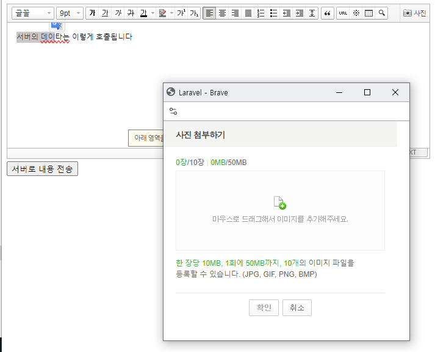

# 🚀 Laravel Editor Hub (`wangta69/laravel-editor`)

> **WYSIWYG · Markdown · Block(JSON) 에디터를 하나의 통일된 인터페이스로 제공하는 라라벨 패키지입니다.**  
> 기존 프로젝트의 코드 수정 없이 설정(`config/pondol-editor.php`) 하나로 **SunEditor, Summernote, EasyMDE, Cherry Markdown, Vditor, Editor.js, Naver SmartEditor2** 등을 자유롭게 교체·혼용할 수 있습니다.

---

## 🌟 Real-world Usage

이 패키지는 **[길라(Gilra)](https://gilra.kr)** (Online Fortune Service)의 커뮤니티 Q&A, 1:1 상담소, 공지사항을 구축하며 실제 운영 환경에서 검증되었습니다.  
특히 **다중 에디터 인스턴스 처리, 스크립트 `defer` 로딩 대응, 이미지 자동 추출/업로드, Light/Dark 테마 전환**을 실서비스 요구에 맞게 고도화했습니다.

---

## ✨ Key Features

- **10종 에디터 통합 지원**: WYSIWYG, Markdown, Block(JSON) 에디터를 동일한 방식으로 호출
- **100% 하위 호환**: 기존 `@include('editor::default', ...)` 및 `<x-editor-components />` 문법 그대로 지원
- **라이트 / 다크 테마 & 툴바 프리셋**: `theme` (`light` | `dark`) 및 `preset` (`minimal` | `standard` | `full`) 지원
- **레이아웃 / 모달 완벽 대응**: `section_mode` (`section` | `stack` | `inline`)로 일반 페이지부터 AJAX 모달까지 지원
- **중복 로드 방지 & 다중 에디터 안전성**: `@once` 기반 에셋 로딩 및 요청 단위 인스턴스 관리 (세션 오염 제거)
- **통합 이미지 업로드 & 보안 검증**: Laravel 10·11·12·13 `public` 디스크 호환, MIME/실제 이미지 바이너리 검증, `ImageUploaded` 이벤트 발행
- **렌더링 헬퍼 내장**: Base64 이미지 파일 추출(`extractBase64Image`), Markdown → HTML(`toHtml`), Editor.js JSON → HTML(`renderEditorJs`)

---

## 📚 Documentation

상세한 사용법과 문서는 [공식 사이트](https://www.onstory.fun/doc/programming/laravel/package.laraveleditor)에서 확인하실 수 있습니다.

---

## 🛠 Installation

### 1. Composer 설치 (PHP 8.1+ / Laravel 10·11·12)

```bash
composer require wangta69/laravel-editor
```

### 2. 오픈소스 로컬 에셋 다운로드 & 퍼블리싱

```bash
# 1) 오픈소스 에디터 정적 파일(JS/CSS) 다운로드 (필요한 것만 받으려면 --only=suneditor,easymde 사용)
php artisan pondol:install-editor assets

# 2) 설정 파일(config/pondol-editor.php), public/plugins/editor 퍼블리싱 및 storage:link 생성
php artisan pondol:install-editor full
```

> **참고:** 특정 에디터만 퍼블리싱하고 싶다면 `--only=suneditor,summernote` 또는 `--tag=public-plugins-suneditor`를 사용할 수 있습니다.

---

## ⚙️ Supported Editors

`config/pondol-editor.php`의 `default-template` 또는 뷰의 `template` 파라미터로 아래 키를 지정할 수 있습니다.

| Key               | Category | Editor Name            | License             | 특징                                                                     |
| :---------------- | :------- | :--------------------- | :------------------ | :----------------------------------------------------------------------- |
| `suneditor`       | WYSIWYG  | **SunEditor**          | MIT                 | **기본값(추천).** 순수 JS(jQuery 불필요), 한국어/표/이미지 리사이즈 최적 |
| `summernote`      | WYSIWYG  | **Summernote Lite**    | MIT                 | 가볍고 익숙한 UI, Bootstrap 비의존 Lite 버전                             |
| `smart-editor`    | WYSIWYG  | **Naver SmartEditor2** | LGPL-2.1            | 국내 게시판에 친숙한 네이버 스마트에디터 (HTML5 멀티 업로드 지원)        |
| `easymde`         | Markdown | **EasyMDE**            | MIT                 | 가볍고 `<textarea>`와 100% 네이티브 호환되는 마크다운 에디터             |
| `cherry-markdown` | Markdown | **Cherry Markdown**    | Apache-2.0          | 실시간 분할 미리보기, Mermaid/수식, HTML→MD 붙여넣기 지원                |
| `vditor`          | Markdown | **Vditor**             | MIT                 | WYSIWYG / 실시간 렌더링(IR) / 분할(SV) 3가지 편집 모드 지원              |
| `editorjs`        | Block    | **Editor.js**          | Apache-2.0          | 노션 스타일 블록 에디터 (깔끔한 JSON 데이터 출력)                        |
| `tinymce`         | WYSIWYG  | **TinyMCE**            | GPLv2+ / Commercial | 강력한 기능 (※ 오픈소스 사용 시 GPL 라이선스 조건 확인 필요)             |
| `froala`          | WYSIWYG  | **Froala Editor**      | Commercial          | 하위 호환용 _(별도 상용 라이선스 필요)_                                  |
| `richtext`        | WYSIWYG  | **RichTextEditor**     | Commercial          | 하위 호환용 _(별도 상용 라이선스 필요)_                                  |

---

## 📖 Quick Start

### 1. Blade Component 방식 (권장)

```blade
{{-- 기본 에디터 (SunEditor, Light 테마) --}}
<x-editor-components name="content" id="content_id" :value="old('content', $article->content ?? '')" />

{{-- 특정 에디터 + 다크 테마 + 심플 툴바 --}}
<x-editor-components
    template="cherry-markdown"
    name="body"
    id="body_id"
    :value="$article->body ?? ''"
    :options="['theme' => 'dark', 'preset' => 'minimal']"
/>
```

### 2. Blade Include 방식 (기존 100% 호환)

```blade
@include('editor::default', [
    'name' => 'content',
    'id' => 'content-id',
    'value' => old('content', $article->content ?? null),
    'attr' => ['class' => 'form-control input-sm'],
])
```

다른 에디터를 일회성으로 지정할 때는 `'template' => 'easymde'`와 `'options'`를 함께 넘기면 됩니다:

```blade
@include('editor::default', [
    'template' => 'easymde',
    'name' => 'markdown_body',
    'id' => 'md-body',
    'value' => $post->markdown_body ?? '',
    'options' => ['theme' => 'dark', 'preset' => 'minimal'],
])
```

---

## 🚀 Advanced Usage

### 1. 한 페이지에 여러 에디터 동시에 사용하기

동일 에디터든 서로 다른 에디터든 ID만 다르면 자동으로 중복 에셋 로딩을 방지하고 각각 독립적으로 동작합니다.

```blade
<x-editor-components template="suneditor" name="summary" id="summary_id" :options="['preset' => 'minimal']" />
<x-editor-components template="easymde" name="detail" id="detail_id" />
```

### 2. AJAX 모달 / 레이아웃 없는 뷰에서 사용하기 (`inline` 모드)

레이아웃에 `@yield('styles')`나 `@yield('scripts')`가 없는 모달·부분 뷰에서는 `section_mode`를 `inline`으로 지정하세요.

```blade
<x-editor-components
    name="reply"
    id="modal_reply"
    :options="['section_mode' => 'inline']"
/>
```

### 3. 본문 렌더링 & 이미지 추출 헬퍼 (`Editor` Facade)

```php
use Pondol\Editor\Facades\Editor;

// 1) Base64 인라인 이미지를 실제 파일로 추출 후 URL 치환 (SVG 등 XSS 위험 포맷 자동 차단)
$html = Editor::extractBase64Image(
    $request->input('content'),
    public_path('uploads/editor'),
    '/uploads/editor/'
);

// 2) Markdown -> 안전한 HTML 변환
$markdownHtml = Editor::toHtml($article->markdown_body);

// 3) Editor.js JSON -> 안전한 HTML 변환
$blockHtml = Editor::renderEditorJs($article->blocks_json);
```

### 4. 이미지 업로드 이벤트 훅 (`ImageUploaded`)

통합 업로더(`/editor/upload`) 또는 SmartEditor 업로드가 성공할 때마다 `Pondol\Editor\Events\ImageUploaded` 이벤트가 발행됩니다. 워터마크, 리사이징, S3 백업 등을 리스너로 연결할 수 있습니다.

```php
use Pondol\Editor\Events\ImageUploaded;

Event::listen(ImageUploaded::class, function (ImageUploaded $event) {
    // $event->disk, $event->path, $event->url, $event->userId 등 활용
});
```

### 5. 기존 `SmartEditor` Trait 직접 사용 (하위 호환)

```php
use Pondol\Editor\Traits\SmartEditor;

class PostController extends Controller
{
    use SmartEditor;

    public function uploadImage(Request $request)
    {
        $result = $this->_uploadStore($request, 'uploads/posts');
        if (! empty($result['error'])) {
            return response()->json(['success' => false]);
        }

        return $result['url'];
    }
}
```

### 6. 임시 업로드 이미지 정리 스케줄러

`storage/app/public/tmp/editor`에 남은 오래된 임시 파일을 정리합니다.

```bash
php artisan pondol:clean-editor-tmp --days=1
```

`routes/console.php` (Laravel 11+)에 등록 예시:

```php
Schedule::command('pondol:clean-editor-tmp --days=1')->daily();
```

---

## 🧪 Tests & Sample Preview

### 브라우저 샘플 확인

패키지 설치 후 아래 URL에서 10종 에디터를 즉시 테스트할 수 있습니다. (기본 미들웨어: `['web', 'auth']`)

- `GET /editor/sample/suneditor`
- `GET /editor/sample/summernote`
- `GET /editor/sample/easymde`
- `GET /editor/sample/cherry-markdown`
- `GET /editor/sample/vditor`
- `GET /editor/sample/editorjs`
- `GET /editor/sample/smart-editor`

### 패키지 단위 테스트 실행

```bash
composer install
composer test
```

---

## 🖼 Screenshots



---

## 🤝 Contribution & Support

- **Issues**: [GitHub Issues](https://github.com/wangta69/laravel-editor/issues)
- **Docs & Support**: [onstory.fun](https://www.onstory.fun)
- **Real-world Case**: [길라(Gilra) 운세 서비스](https://gilra.kr)

---

Copyright © wangta69. Licensed under the **MIT License**.
